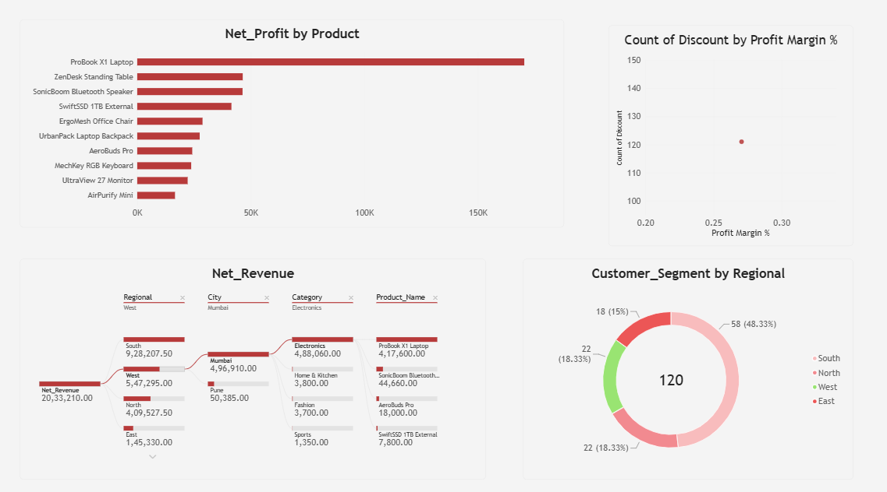
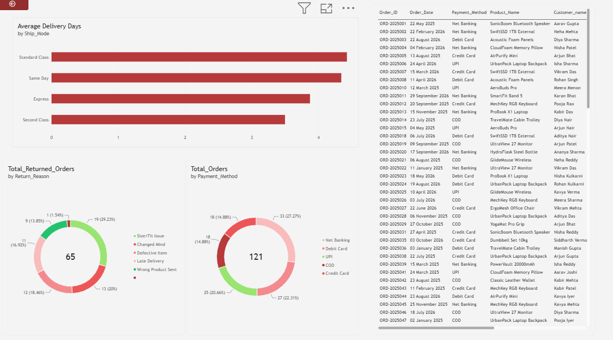

# ShopSphere India – Executive Sales & Business Performance Dashboard

## Project Overview

ShopSphere India is an e-commerce analytics project developed using **Microsoft Power BI** to analyze sales performance, profitability, customer behavior, product performance, logistics, and product returns.

The primary objective of this project is to transform raw operational data into meaningful business insights through data cleaning, data modeling, DAX calculations, and interactive dashboard development.

The project follows a structured Business Intelligence workflow, starting from raw data transformation and ending with an interactive three-page executive dashboard.

## Project Objectives

- Analyze overall sales and revenue performance.
- Evaluate profitability and profit margins.
- Identify top-performing products and customer segments.
- Understand regional and category-wise sales performance.
- Analyze shipping timelines and return patterns.
- Evaluate customer payment method preferences.
- Provide actionable insights to support business decision-making.

## Tools & Technologies

- **Microsoft Power BI Desktop** – Dashboard development and data visualization
- **Power Query** – Data cleaning and transformation
- **DAX (Data Analysis Expressions)** – KPI calculations and business metrics
- **Data Modeling** – Star Schema and table relationships
- **Microsoft Excel / CSV** – Source data handling

## Dataset Overview

The project uses four raw operational datasets provided for ShopSphere India.

| Dataset | Description |
|---|---|
| `orders_raw.csv` | Transactional order data, including dates, quantities, unit prices, discounts, shipping modes, and payment methods |
| `customers_raw.csv` | Customer profiles containing city, state, region, and customer segment information |
| `products_raw.csv` | Product details, including categories, sub-categories, unit costs, selling prices, and suppliers |
| `returns_raw.csv` | Product return records containing order references, return dates, reasons, and refund statuses |

The datasets cover e-commerce operations across 2025–2026.

## Data Cleaning & Transformation

Data preparation was performed using Power Query to improve data quality and ensure consistency before analysis.

Key transformation activities included:

- Removed duplicate records from the source tables.
- Standardized text casing and trimmed unwanted spaces.
- Cleaned inconsistent category, city, shipping mode, and payment method values.
- Corrected mixed date formats in the Orders dataset.
- Handled missing discount values.
- Addressed negative quantity values.
- Filled missing region information using the corresponding state.
- Created a dedicated Calendar table covering January 2025 to December 2026.

## Data Modeling

A Star Schema data model was developed to organize the datasets and support efficient analysis.

The model includes:

- **Fact Table:** Orders
- **Dimension Tables:** Customers, Products, and Calendar
- **Returns Table:** Connected to Orders using Order_ID
- **Measures Table:** Dedicated table for DAX calculations

One-to-many relationships were established between the dimension tables and the Orders fact table, with appropriate filter directions.

## Key DAX Measures

The following DAX measures were developed to evaluate business performance:

| Measure | Business Purpose |
|---|---|
| Gross Sales | Calculates sales before discounts |
| Total Discount | Calculates the total discount amount |
| Net Revenue | Calculates revenue after discounts |
| Total Cost | Calculates the total product cost |
| Net Profit | Measures profit after product costs |
| Profit Margin % | Evaluates profitability as a percentage of revenue |
| Total Orders | Counts unique orders |
| Return Rate % | Measures the percentage of orders returned |
| Average Order Value (AOV) | Calculates average revenue per order |
| MoM Revenue Growth % | Measures month-over-month revenue growth |

## Dashboard Development

The Power BI report contains three interactive dashboard pages.

### 1. Executive Summary

Provides a high-level overview of the company's business performance.

**Key Visualizations:**
- KPI Cards – Net Revenue, Net Profit, Profit Margin %, Total Orders, and Return Rate %
- Monthly Revenue and Profit Trend
- Revenue by Product Category
- Regional Sales Map of India

**Business Focus:** Monitor overall business performance, identify revenue trends, and compare regional and category-wise sales.
### Executive Summary

### 2. Product & Customer Insights

Focuses on product profitability and customer-related performance.

**Key Visualizations:**
- Top 10 Products by Profit
- Customer Segment Distribution
- Discount % vs. Profit Margin % Scatter Plot
- Decomposition Tree for Net Revenue

**Business Focus:** Identify profitable products, understand customer segments, and explore factors influencing revenue and profitability.
### Product & Customer Insights

### 3. Logistics & Returns Analysis

Analyzes shipping timelines, return patterns, and payment preferences.

**Key Visualizations:**
- Average Order-to-Ship Days by Ship Mode
- Returns Breakdown by Return Reason
- Payment Method Distribution
- Interactive Order Details Table with Drill-through

**Business Focus:** Compare order processing and shipping timelines, identify common return reasons, and understand customer payment preferences.
### Logistics & Returns Analysis

*Note: The dataset contains Order Date and Ship Date, but not an actual delivery date. Therefore, the shipping analysis measures the time between order placement and shipment, not final customer delivery time.*

## Key Business Insights

The dashboard helps business users:

- Monitor revenue, profit, and profitability trends.
- Identify high-performing product categories and regions.
- Recognize products contributing significantly to overall profit.
- Understand customer segment distribution.
- Identify frequently reported product return reasons.
- Compare order-to-ship timelines across shipping modes.
- Evaluate the distribution of customer payment methods.

## Project Deliverables

- Power BI report file (`.pbix`)
- PDF export containing all three dashboard pages
- Five-bullet executive summary highlighting business findings and recommendations

## Conclusion

The ShopSphere India Power BI project demonstrates an end-to-end Business Intelligence workflow, including data preparation, data modeling, DAX measure development, and interactive dashboard design.

By converting raw e-commerce data into meaningful visual insights, this project supports data-driven decision-making across sales, product performance, customer behavior, and logistics operations.

---

**Project Category:** Business Intelligence | E-Commerce Analytics | Data Visualization

**Developed Using:** Microsoft Power BI | Power Query | DAX# Power-BI-Project-Repository
